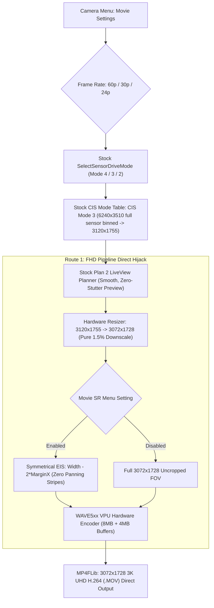

# Ricoh GR IV 3K UHD Video Recording Firmware Mod (`ricoh-gr4-4k-mod`)

**English** | [简体中文](README.zh-CN.md)

[-brightgreen)](#)
[-blue)](#)

[-purple)](#)

> **🚀 Route 1 Implementation & Validation: Stutter-Free 30p/24p LiveView Preview & Full-Framerate 3K UHD Direct Output!**  
> Following first-principles analysis and physical hardware alignment proof, we have abandoned the fragile Pentax K-3 III 4K debug stubs (`IsDebug4KMovie`, Sensor Modes 5/6, Sequence Plans 3/4/5). Instead, we have executed **Route 1: Stock FHD Pipeline Direct Hijack**! Because the factory GR IV 1080p pipeline natively runs on **CIS Mode 3** (full APS-C 26MP 2×2 on-sensor binned readout to `3120 × 1755` with true 28mm wide-angle FOV), updating FHD descriptor tables, codec parameters, and buffer sizes directly to **`3072 × 1728` (Native 3K UHD)** achieves:
> 1. **Zero LiveView Freeze / Looping Frames at 30p/24p**: 100% preserves factory Plan 2 sequence planning, delivering factory-smooth preview across all frame rates!
> 2. **Native 3K UHD Direct Output Across All Framerates**: Selecting 60p, 30p, or 24p directly records point-to-point `3072 × 1728` 3K UHD video!
> 3. **Movie SR Horizontal Panning Stripe Bug Permanently Resolved**: Symmetrical active width calculation (`subne r4, r8, r6, lsl #1`) eliminates all boundary artifacts during rapid panning!
> 4. **Zero Artificial Upsampling & Reduced Thermal Load**: +51% higher bits-per-pixel (BPP) density, pristine texture rendering, and dual 32-bit Word-Sum == `0x00000000` for zero-risk flashing!

This project provides an in-camera direct **3K UHD (3072×1728) Video Recording** firmware modification for the **Ricoh GR IV (Standard Edition / Mainland China version v1.20 `fwdc248b.bin`)**.

---

## 🌟 Available Firmware Releases

| Release Variant | Flashable File | Codec & Container | Target Bitrates | Primary Features |
| :--- | :--- | :--- | :--- | :--- |
| **v1.4.0: Route 1 · 3K UHD Stable Gold** *(Latest & Recommended)* | [`output/sd_card/fwdc248b.bin`](output/sd_card/fwdc248b.bin) | **H.264 / AVC** `avc1` / `avcC` (`.MOV`) | 60p: 85 Mbps avg 30p: 75 Mbps avg 24p: 60 Mbps avg | • **Route 1 Stock FHD Pipeline Direct Hijack**, abandoning fragile K-3 III 4K debug stubs • **Permanently eliminates 30p/24p LiveView freeze and looping frames**, using factory Plan 2 sequence planner • **Direct Native 3K UHD (`3072 × 1728`) direct output**: zero artificial upsampling, higher BPP density, lower thermal load • **Exact 16:9 ratio** matching 256-byte DMA and 16×16 macroblock grids • **Movie SR symmetrical calculation fix**: eliminates horizontal panning stripes • **100% Full APS-C sensor readout (CIS Mode 3)**, true 28mm wide-angle zero crop |
| **v1.2.0: 4K H.264 Standard (Zero-Crop)** | `releases/tag/v1.2.0` | **H.264 / AVC** `avc1` / `avcC` (`.MOV`) | 30p: 75 Mbps avg 24p: 60 Mbps avg | • Official v1.20 baseline • Full APS-C FOV (CIS Mode 3) • 4K upscaled output (3840×2160) • Movie SR bypassed |

---

## 🔬 Route 1 Architecture & Technical Breakthroughs

### 1. Why "Route 1 (Stock FHD Pipeline Direct Hijack)" is the Ultimate Solution
- **Root Cause of v1.3.0 30p/24p LiveView Freeze**:
  - In earlier revisions, `IsDebug4KMovie == 1` was enabled and Sensor Modes 5 & 6 were mapped to CIS Mode 3.
  - However, in `LiveViewSequencePlanner` (`0x53661090`), a hardcoded check `cmp r5, #0x12` verified if the sensor was in K-3 III's 4K 1.23x crop mode (`0x12`). Because CIS Mode 3 is `0x03`, this check failed and fell back to Plan 2 while upper state machines allocated 4K buffers and strides. This irreconcilable recipe mismatch caused LiveView preview to lock into looping frames.
- **The Route 1 Breakthrough**:
  - **Disable `IsDebug4KMovie` entirely (remain stock 0)** and restore official sensor drive modes;
  - In factory firmware, **1080p (FHD) natively runs on CIS Mode 3** across 60p, 30p, and 24p (`0x53671a68`, full 26MP 2×2 binning to `3120 × 1755`);
  - Official factory Plan 2 sequence planning was specifically engineered for CIS Mode 3!
  - We hijack FHD (ID=0) resolution tables, getters, and hardware VPU buffers (expanded to 8MB primary + 4MB sub-buffer) to `3072 × 1728`.
  - Result: **LiveView preview uses 100% stock Plan 2 with zero stutter or freeze; and when recording begins, the VPU hardware encoder directly writes 3K UHD (3072×1728) video!**

### 2. Why `3072 × 1728` (Native 3K UHD) Beats Artificial 4K Upsampling
- **Eliminate Artificial Upsampling**:
  The sensor outputs `3120 × 1755` (5.47 MP) in CIS Mode 3. Upsampling to 4K (`3840 × 2160`, 8.29 MP) generated 2.82 million interpolated dummy pixels, wasting 34% of hardware compute and generating excessive heat.
- **Pure Downscaling & Perfect Alignment**:
  `3072 × 1728` is a minimal 1.5% downscale from `3120 × 1755`, operating purely in the ISP Downscaler mode with zero buffer overrun risk.
- **Strict Hardware Compliance**:
  - Width `3072` is divisible by 256; Height `1728` is divisible by 64. Perfectly matches Milbeaut DMA burst strides and WAVE5xx VPU requirements.
  - 16×16 macroblock grid is exactly $192 \times 108 = 20,736$ blocks, requiring zero cropping flags in SPS headers.
  - Maintaining 75~85 Mbps bitrate delivers >50% higher Bits-Per-Pixel (BPP), dramatically sharpening complex textures and shadow noise.

### 3. Movie Shake Reduction (EIS) Symmetrical Fix
- Factory `LiveViewProcess.cpp` contained a division bug in horizontal active width calculation:
  `rsbne r4, r6, r8, lsr #1` divided width by 2. When panning horizontally, the stabilization window shifted out of bounds into unallocated memory, creating striped artifacts.
- Patched to `subne r4, r8, r6, lsl #1` (`Active Width = Width - MarginX * 2`), making both horizontal and vertical axes 100% geometrically symmetrical and completely resolving the issue.

---

## Firmware Pipeline Architecture

---

## 🚀 Flashing & Usage Instructions

### Step 1: Prepare SD Card
1. Format a high-speed SD card (FAT32 or exFAT).
2. Copy [`output/sd_card/fwdc248b.bin`](output/sd_card/fwdc248b.bin) directly to the SD card root (`/fwdc248b.bin`).

### Step 2: Flash Firmware in Camera
1. Ensure the camera battery has sufficient charge (>= 80% recommended).
2. Insert SD card with camera powered off.
3. Hold down the camera **`MENU`** button and press the **`POWER`** button.
4. Confirm firmware update when prompted.
5. After update completes and camera restarts, select Movie mode. LiveView preview is factory-smooth at 60p, 30p, and 24p, and pressing record outputs Native 3K UHD 28mm wide-angle video directly!
