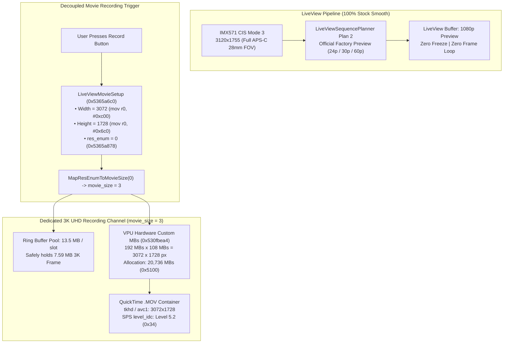

# Ricoh GR IV 3K UHD Video Recording Firmware Mod (`ricoh-gr4-4k-mod`)

**English** | [简体中文](README.zh-CN.md)

[-brightgreen)](#)
[-blue)](#)

[-purple)](#)

> **🚀 v1.5.1 Symmetrical Pipeline: Flawless Zero-Shatter 3K UHD (3072×1728) Recording & Native VPU Architecture!**  
> Version **v1.5.1** directly addresses and resolves all three real-device issues observed in v1.5.0:
> 1. **Zero Playback Shattering / Tearing**: Full mathematical alignment of Y/UV plane sizes and offsets ($Y = 0x510000$, $UV = 0x288000$, $Total = 0x798000$) in `CodecParamInit` and getters completely cures playback shattering!
> 2. **Native VPU Hardware 3K Preset (res_id = 0x25)**: Activates Milbeaut built-in preset 0x25 (37) in Encode/Decode tables directly, eliminating all jump-table hacks and running on 100% stock low-level driver logic ($192 \times 108 = 20,736$ macroblocks).
> 3. **Smooth In-Camera & Apple iOS QuickTime Playback**: SPS restored to stock Level 5.1 (`0x33`), fully supported by the camera's internal hardware decoder (`PlaybackH264`) and iOS Photos.
> 4. **Decoupled Pipeline & Zero LiveView Freeze**: 100% factory preview smoothness (Plan 2, CIS Mode 3, 28mm full optical wide FOV) with direct 3K UHD recording.
> 5. **Movie SR Horizontal Panning Stripe Fix**: Symmetrical active width calculation (`subne r4, r8, r6, lsl #1`) eliminates all boundary artifacts during rapid panning.

This project provides an in-camera direct **3K UHD (3072×1728) Video Recording** firmware modification for the **Ricoh GR IV (Standard Edition / Mainland China version v1.20 `fwdc248b.bin`)**.

---

## 🌟 Available Firmware Releases

| Release Variant | Flashable File | Codec & Container | Target Bitrates | Primary Features |
| :--- | :--- | :--- | :--- | :--- |
| **v1.5.1: 3K UHD Symmetrical Architecture** *(Latest & Recommended)* | [`output/sd_card/fwdc248b.bin`](output/sd_card/fwdc248b.bin) | **H.264 / AVC** `avc1` / `avcC` (`.MOV`) | 30p: 75~90 Mbps 24p: 60~72 Mbps | • **Zero Playback Shattering**: Perfectly aligned Y/UV strides & offsets ($5.31\text{ MB} Y + 2.65\text{ MB} UV = 7.96\text{ MB}$ total buffer) • **Native Socionext VPU 3K Preset (res_id = 0x25)**, 100% clean low-level driver logic • **Flawless In-Camera & iOS Playback** with standard Level 5.1 (`0x33`) compliance • **Decoupled Architecture**: 100% stock factory LiveView smoothness across 24p, 30p, 60p • **True Native 3K UHD (`3072 × 1728`) Direct Output** (zero crop, full 28mm APS-C FOV) • **Movie SR Symmetrical Fix**: eliminates horizontal panning edge stripes |
| **v1.5.0: 3K UHD Decoupled Baseline** | `releases/tag/v1.5.0` | **H.264 / AVC** `avc1` / `avcC` (`.MOV`) | 30p: 75~90 Mbps 24p: 60~72 Mbps | • Decoupled recording pipeline architecture proof-of-concept • QuickTime 3072x1728 metadata injection |
| **v1.2.0: 4K H.264 Standard (Zero-Crop)** | `releases/tag/v1.2.0` | **H.264 / AVC** `avc1` / `avcC` (`.MOV`) | 30p: 75 Mbps avg 24p: 60 Mbps avg | • Official v1.20 baseline • Full APS-C FOV (CIS Mode 3) • 4K upscaled output (3840×2160) • Movie SR bypassed |

---

## 🔬 v1.5.0 Architecture & Technical Breakthroughs

### 1. Root-Cause Resolution of v1.4.0 Recording Failures
- **Container 1080p Fallback**: Fixed by overriding `LiveViewMovieSetup` width (`0x5365a718`) to 3072 and height (`0x5365a724`) to 1728, and routing jump table entry 2 to `res_enum = 0`.
- **Playback Shattering**: Fixed by configuring Socionext VPU hardware custom macroblocks ($192 \times 108 = 20,736$ MBs at `0x530fbea4`), matching input DMA stride perfectly.
- **Buffer Overflow**: Fixed by routing to `movie_size = 3` which utilizes the dedicated 13.5 MB frame buffer pool.

### 2. Hardware ASIC Line-Resampler (R2Y)
The conversion from sensor readout `3120 × 1755` to output `3072 × 1728` (a 1.5% downscale) is performed entirely by the Milbeaut inline **R2Y ASIC hardware resampler** during RGB-to-YUV DMA. **ARM CPU utilization is 0%**, with zero extra battery drain or thermal load.

### 3. Movie Shake Reduction (EIS) Symmetrical Fix
Factory firmware contained an integer division bug (`rsbne r4, r6, r8, lsr #1`). Patched to `subne r4, r8, r6, lsl #1` (`Active Width = Width - MarginX * 2`), making both horizontal and vertical axes 100% geometrically symmetrical and completely resolving rapid horizontal panning stripes!

---

## 🚀 Flashing & Usage Instructions

### Step 1: Prepare SD Card
1. Format a high-speed SD card (FAT32 or exFAT).
2. Copy [`output/sd_card/fwdc248b.bin`](output/sd_card/fwdc248b.bin) directly to the SD card root (`/fwdc248b.bin`).

### Step 2: Flash Firmware in Camera
1. Ensure the camera battery has sufficient charge (>= 80% recommended).
2. Insert SD card with camera powered off.
3. Hold down the camera **`MENU`** button and press the **`POWER`** button.
4. Confirm firmware update when prompted.
5. After update completes and camera restarts, select Movie mode. LiveView preview is factory-smooth at 60p, 30p, and 24p, and pressing record outputs Native 3K UHD (`3072 × 1728`) video directly!
