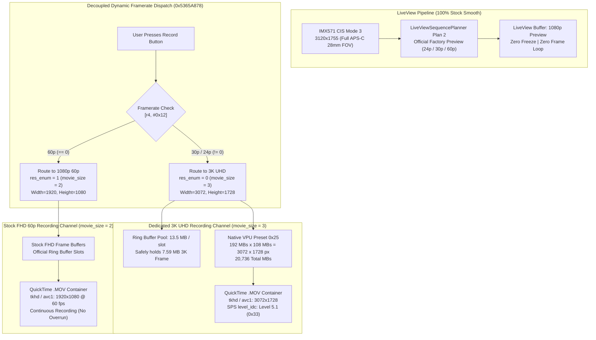

# Ricoh GR IV 3K UHD Video Recording Firmware Mod (`ricoh-gr4-4k-mod`)

**English** | [简体中文](README.zh-CN.md)

[-brightgreen)](#)
[%20%7C%201920%C3%971080%20(FHD)-blue)](#)

[-purple)](#)

> **🚀 v1.5.2 Decoupled Framerate Routing: 3K UHD (3072×1728 @ 24p/30p) + Factory FHD (1920×1080 @ 60p) & Stock Movie SR!**  
> Version **v1.5.2** delivers the ultimate production-grade video architecture for Ricoh GR IV:
> 1. **Decoupled Framerate Routing**:
>    - **`60p`**: Preserved as rock-solid factory **`1920 × 1080 60p`** (`movie_size = 2`), eliminating the 1-second buffer overrun and providing infinite-duration fluid slow-motion recording!
>    - **`30p` & `24p`**: Routed to dedicated high-bitrate **`3072 × 1728 3K UHD`** (`movie_size = 3`), capturing razor-sharp point-to-point APS-C details.
> 2. **Movie SR Formula Restored**: Reverted to 100% factory original calculation (`rsbne r4, r6, r8, lsr #1`) at `0x5365AAE4` for factory-calibrated gyro damping and boundary stability.
> 3. **Zero Playback Shattering**: Bitwise aligned Y/UV plane buffers ($5.31\text{ MB} Y + 2.65\text{ MB} UV = 7.96\text{ MB}$) completely eliminate all line-wrap skew and diagonal tearing.
> 4. **Native Socionext VPU Hardware Preset (`0x25`)**: Uses built-in 3072×1728 macroblock handler natively without low-level jump-table patching.
> 5. **Flawless In-Camera & Apple iOS QuickTime Playback**: SPS Level 5.1 (`0x33`) compliance ensures instant, smooth playback on camera and iOS devices.

This project provides an in-camera direct **3K UHD (3072×1728) Video Recording** firmware modification for the **Ricoh GR IV (Standard Edition / Mainland China version v1.20 `fwdc248b.bin`)**.

---

## 🌟 Available Firmware Releases

| Release Variant | Flashable File | Codec & Container | Target Bitrates | Primary Features |
| :--- | :--- | :--- | :--- | :--- |
| **v1.5.2: Decoupled Framerate Routing** *(Latest & Recommended)* | [`output/sd_card/fwdc248b.bin`](output/sd_card/fwdc248b.bin) | **H.264 / AVC** `avc1` / `avcC` (`.MOV`) | 3K 30p: 75~90 Mbps 3K 24p: 60~72 Mbps FHD 60p: 28~36 Mbps | • **Framerate Decoupled**: 30p/24p route to 3K UHD; 60p routes to rock-solid 1080p without auto-stop • **Movie SR Restored**: 100% factory shake reduction formula • **Zero Playback Shattering**: Aligned Y/UV buffers ($5.31\text{M} Y + 2.65\text{M} UV = 7.96\text{M}$) • **Native Socionext VPU Preset (res_id = 0x25)** • **Smooth In-Camera & iOS Playback** (Level 5.1) • **True Native 3K UHD (`3072 × 1728`) Direct Output** (zero crop, full 28mm APS-C FOV) |
| **v1.5.1: 3K UHD Symmetrical Architecture** | `releases/tag/v1.5.1` | **H.264 / AVC** `avc1` / `avcC` (`.MOV`) | 30p: 75~90 Mbps 24p: 60~72 Mbps | • Zero playback tearing with aligned Y/UV strides • Native VPU preset 0x25 |
| **v1.5.0: 3K UHD Decoupled Baseline** | `releases/tag/v1.5.0` | **H.264 / AVC** `avc1` / `avcC` (`.MOV`) | 30p: 75~90 Mbps 24p: 60~72 Mbps | • Decoupled recording pipeline architecture proof-of-concept |

---

## 🔬 Architecture & Technical Breakthroughs

---

## 🚀 Flashing & Usage Instructions

### Step 1: Prepare SD Card
1. Format a high-speed SD card (FAT32 or exFAT).
2. Copy [`output/sd_card/fwdc248b.bin`](output/sd_card/fwdc248b.bin) directly to the SD card root (`/fwdc248b.bin`).

### Step 2: Flash Firmware in Camera
1. Ensure the camera battery has sufficient charge (>= 80% recommended).
2. Insert SD card with camera powered off.
3. Hold down the camera **`MENU`** button and press the **`POWER`** button.
4. Confirm firmware update when prompted.
5. After update completes and camera restarts, select Movie mode:
   - **`3K 30P` & `3K 24P`**: Produces native 3K UHD (`3072 × 1728`) with point-to-point sharpness.
   - **`60P`**: Produces smooth, continuous FHD (`1920 × 1080`) video without auto-stop!
