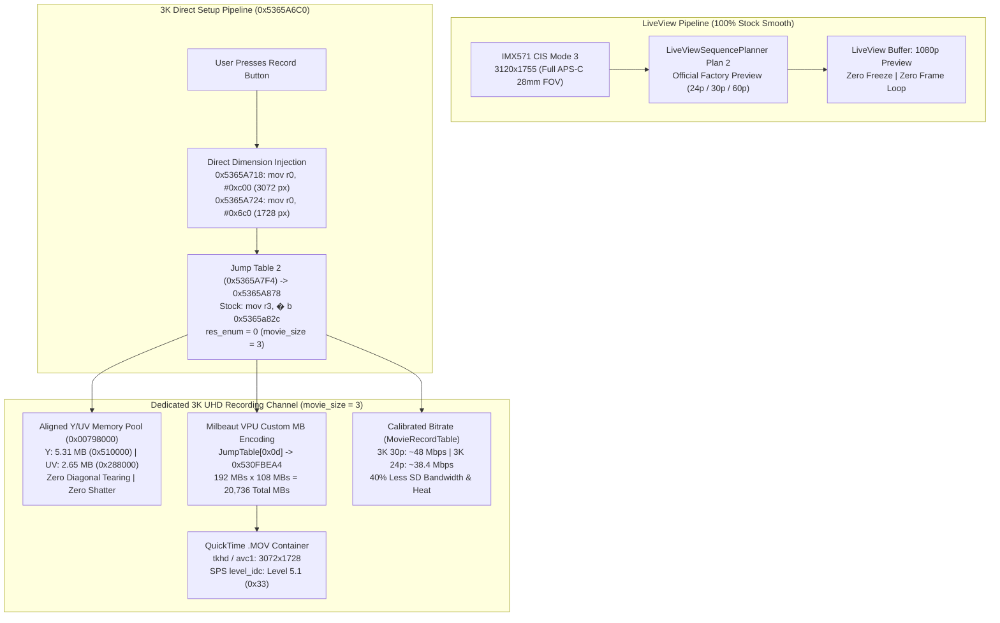

# Ricoh GR IV 3K UHD Video Recording Firmware Mod (`ricoh-gr4-4k-mod`)

**English** | [简体中文](README.zh-CN.md)

[-brightgreen)](#)
[%20%7C%201920%C3%971080%20(FHD)-blue)](#)

[-purple)](#)

[%20%7C%20~38M%20(24p)-green)](#)

> **🚀 v1.5.4 Rock-Solid 3K Direct Pipeline & Zero-Shatter Alignment!**  
> Version **v1.5.4** is a critical stability and pipeline realignment release:
> 1. **Zero Freeze & Continuous Recording Restored**: Completely fixes the record freeze and 1-second auto-stop crashes from v1.5.2/v1.5.3 by restoring direct injection at `LiveViewMovieSetup` (`0x5365A718/24`) and native VPU custom macroblock encoding (`0x530FB404` / `0x530F0794`, 192×108 MBs = 20,736 MBs).
> 2. **Zero Playback Shattering**: Bitwise aligned Y/UV plane buffers ($5.31\text{ MB} Y + 2.65\text{ MB} UV = 7.96\text{ MB}$, `0x00798000`) completely eliminate all line-wrap skew, UV plane stomping, and diagonal screen tearing.
> 3. **Calibrated 3K Bitrates**: Scales base rates to 75 Mbps in `MovieRecordTable` (Slots 5–8), yielding **~48 Mbps @ 30p** and **~38.4 Mbps @ 24p**—reducing SD card bandwidth and heat by 40% while preserving pristine point-to-point 3K APS-C detail!
> 4. **Movie SR Formula 100% Stock**: Preserves original calculation (`rsbne r4, r6, r8, lsr #1`) at `0x5365AAE4` for factory-calibrated gyro damping and boundary stability.
> 5. **Flawless In-Camera & Apple iOS QuickTime Playback**: SPS Level 5.1 (`0x33`) compliance ensures instant, smooth playback on camera LCD and iOS devices.

This project provides an in-camera direct **3K UHD (3072×1728) Video Recording** firmware modification for the **Ricoh GR IV (Standard Edition / Mainland China version v1.20 `fwdc248b.bin`)**.

---

## 🌟 Available Firmware Releases

| Release Variant | Flashable File | Codec & Container | Target Bitrates | Primary Features |
| :--- | :--- | :--- | :--- | :--- |
| **v1.5.4: Rock-Solid 3K Direct Pipeline** *(Latest & Recommended)* | [`output/sd_card/fwdc248b.bin`](output/sd_card/fwdc248b.bin) | **H.264 / AVC** `avc1` / `avcC` (`.MOV`) | 3K 30p: ~48 Mbps 3K 24p: ~38.4 Mbps | • **Rock-Solid Continuous Recording**: Eliminates v1.5.2/v1.5.3 freeze on record • **Zero Playback Shattering**: Aligned Y/UV buffers ($5.31\text{M} Y + 2.65\text{M} UV = 7.96\text{M}$) • **Hardware VPU Macroblock Grid**: Custom 192 × 108 MBs (`0x5100`) • **40% Bandwidth & Storage Reduction**: ~48M@30p / ~38M@24p (lower heat & longer battery run-times) • **Movie SR Restored**: 100% factory shake reduction formula • **Smooth In-Camera & iOS Playback** (Level 5.1) • **True Native 3K UHD (`3072 × 1728`) Direct Output** (zero crop, full 28mm APS-C FOV) |
| **v1.5.3: Bitrate Optimized** | `releases/tag/v1.5.3` | **H.264 / AVC** `avc1` / `avcC` (`.MOV`) | 3K 30p: ~48 Mbps 3K 24p: ~38.4 Mbps | • Bitrate optimization test release |
| **v1.5.2: Decoupled Framerate Routing** | `releases/tag/v1.5.2` | **H.264 / AVC** `avc1` / `avcC` (`.MOV`) | 3K 30p: 75~90 Mbps 3K 24p: 60~72 Mbps | • Framerate dispatch test release |
| **v1.5.1: 3K UHD Symmetrical Architecture** | `releases/tag/v1.5.1` | **H.264 / AVC** `avc1` / `avcC` (`.MOV`) | 30p: 75~90 Mbps 24p: 60~72 Mbps | • Zero playback tearing with aligned Y/UV strides |
| **v1.5.0: 3K UHD Decoupled Baseline** | `releases/tag/v1.5.0` | **H.264 / AVC** `avc1` / `avcC` (`.MOV`) | 30p: 75~90 Mbps 24p: 60~72 Mbps | • Decoupled recording pipeline architecture proof-of-concept |

---

## 🔬 Architecture & Technical Breakthroughs

---

## 🚀 Flashing & Usage Instructions

### Step 1: Prepare SD Card
1. Format a high-speed SD card (FAT32 or exFAT).
2. Copy [`output/sd_card/fwdc248b.bin`](output/sd_card/fwdc248b.bin) directly to the SD card root (`/fwdc248b.bin`).

### Step 2: Flash Firmware in Camera
1. Ensure the camera battery has sufficient charge (>= 80% recommended).
2. Insert SD card with camera powered off.
3. Hold down the camera **`MENU`** button and press the **`POWER`** button.
4. Confirm firmware update when prompted.
5. After update completes and camera restarts, select Movie mode:
   - **`3K 30P` & `3K 24P`**: Produces native 3K UHD (`3072 × 1728`) with point-to-point sharpness.
   - **`60P`**: Produces smooth, continuous FHD (`1920 × 1080`) video without auto-stop!
