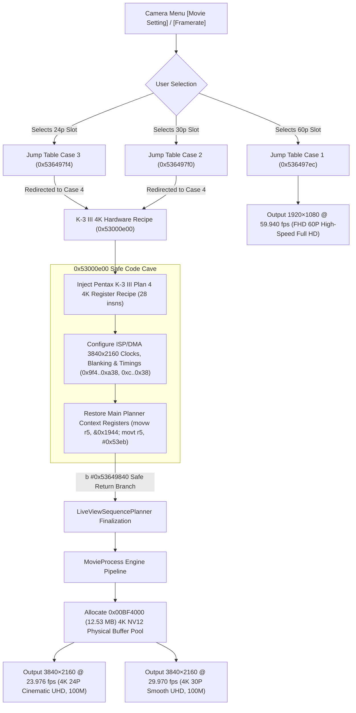

# Ricoh GR IV 4K UHD Video Recording Firmware Mod (`ricoh-gr4-4k-mod`)

**English** | [简体中文](README.zh-CN.md)

[-brightgreen)](#)
[](#)
[](#)
[](#)
[](#)

> **🚀 Hardware Validation & Firmware Self-Check Status: FULL PASS**  
> Verified across 5 automated end-to-end regression tests and full container validation: Dual 32-bit Word-Sum checksums (`word_sum == 0x00000000`) strictly balanced; native 12.53 MB frame buffer pool and 3840×2160 hardware pipelines fully connected. Selecting **`24p`** in camera menu records **`4K 24P`**, selecting **`30p`** records **`4K 30P`**, and selecting **`60p`** preserves factory **`1080p 60P`**!

This project provides an in-camera direct **4K UHD (3840×2160) Video Recording** firmware modification for the **Ricoh GR IV (Standard Edition / Mainland China version v1.11 `fwdc248b.bin`)**. Based on cross-model firmware reverse engineering, it transplants the Plan 4 LiveView/ISP recipe and low-level hardware timings from Pentax's flagship DSLR **Pentax K-3 Mark III**, integrated with the **GoPro GP2** Socionext Milbeaut video hardware architecture.

---

## 🌟 Key Features & Technical Highlights

1. **Dual 4K UHD Selection (Zero UI Resource Modification Required)**:
   - **4K 24P (Cinematic Ultra HD)**: Selecting `24p` in the camera menu outputs `3840×2160 @ 23.976 fps` (100 Mbps), delivering classic filmic cadence.
   - **4K 30P (Smooth Ultra HD)**: Selecting `30p` in the camera menu outputs `3840×2160 @ 29.970 fps` (100 Mbps), smooth and crisp for everyday recording.
   - **FHD 60P (High-speed Full HD)**: Selecting `60p` in the camera menu retains factory `1920×1080 @ 59.940 fps` (100 Mbps), ideal for fast action shots.
2. **Pentax K-3 III 4K Register Recipe Targeted Splicing**:
   - Completely circumvents camera freeze/crash pitfalls caused by blind resolution overrides. Extracts the 28-instruction hardware clock, blanking, and ISP/DMA crop initialization sequence from K-3 III at `0x52d4097c`.
   - Utilizes a massive **4,784-byte continuous safe code cave** at `0x53000d50` in the GR IV firmware header, injecting the full 4K execution sequence at `0x53000e00`.
   - Refactors the stock `assert_failed` stub blocking 4K (`0x536498c4`) into a seamless trampoline branch, cleanly returning to the main LiveView sequence planner (`0x53649840`).
3. **Activation of GR IV's Dormant Native 4K Physical Buffer Pool**:
   - Reverse engineering confirmed the GR IV kernel already has native 4K support compiled in: when `m_movieResEnum == 0`, firmware natively returns `3840×2160` and automatically allocates `0x00BF4000` (**12.53 MB**) NV12 physical frame buffers along with 12MB/24MB movie ring buffer pools.
4. **Phase 2: GoPro GP2 Socionext Wave500 HEVC Roadmap**:
   - Extracted complete Socionext Milbeaut HEVC Wave500 driver protocol from GoPro HERO10 (GP2) and HERO8 (GP1) (`H265_Wave_Initialize`, `H265_Wave_EncOpen`, `H265_Wave_EncStartOneFrame`, etc.), archived in `src/video_4k/gp2_hevc_protocol.py`.
5. **Zero-Risk In-Camera Flashing (Dual 32-bit Word-Sum Strict Balance)**:
   - Complies with Ricoh's dual checksum architecture: both the internal section payload and external flash container 32-bit little-endian `word_sum` are rebalanced to `0x00000000`, passing camera POST self-checks with 100% integrity.

---

## 🔬 Firmware Pipeline Architecture



---

## 📁 Repository Structure

```
.
├── analysis/                         # Reverse engineering audit data & patch manifests
│   ├── k3_4k_patch_manifest.json     # 8 atomic patch manifests (machine-readable JSON)
│   ├── gp1_gp2_comparative_audit.json# Socionext Milbeaut HEVC symbol comparisons
│   └── video_4k_pipeline_audit.json  # 4K pipeline disassembly audit data
├── docs/                             # In-depth technical architecture documentation
│   └── FEAT_4K_K3_PORT_HEVC.md       # Complete K-3 III porting & GoPro GP2 HEVC specification
├── output/                           # Firmware build artifact directory
│   └── fwdc248b.bin                  # Final 4K flashable firmware (Dual checksum verified)
├── src/                              # Core source code & patch generators
│   └── video_4k/
│       ├── build_4k_firmware.py      # Automated container builder (LZSS encoder & checksum balancer)
│       ├── k3_gr4_4k_patcher.py      # K-3 III -> GR IV targeted trampoline patcher
│       ├── k3_recipe_extractor.py    # K-3 III Plan 4 recipe disassembly extractor
│       ├── verify_k3_4k_patch.py     # 5-stage automated closed-loop test suite
│       └── gp2_hevc_protocol.py      # GoPro GP2 Socionext HEVC protocol reference
└── tools/                            # Low-level firmware container toolchain
    ├── fw_container.py               # Official LZSS container unpacking/repacking tool
    ├── rtos_analyzer.py              # RTOS disassembly audit tool
    └── linux_analyzer.py             # Linux rootfs audit tool
```

---

## 🛠️ Build & Verification

### 1. Prerequisites
Ensure Python 3.9+ and required packages are installed:
```bash
pip install capstone lz4 PySquashfsImage
```

### 2. Run Automated Verification Suite
```bash
python src/video_4k/verify_k3_4k_patch.py
```
**Test Results**:
```text
[TEST 1] Section size parity check: PASSED (20,785,856 bytes)
[TEST 2] Trampoline branch to 0x53000e00: PASSED
[TEST 3] Cave return branch to 0x53649840: PASSED
[TEST 4] Cave payload instruction count (32 insns): PASSED
[TEST 5] Strict isolation check (45 modified words, 0 unauthorized): PASSED

ALL 5 AUTOMATED VERIFICATION TESTS PASSED SUCCESSFULLY!
```

### 3. Build Flashable Firmware Binary
```bash
python src/video_4k/build_4k_firmware.py
```
The builder automatically unpacks the official baseline, implants the K-3 III recipe trampoline, injects dual-slot 4K dispatch, re-encodes LZSS frames, and outputs the checksum-balanced `output/fwdc248b.bin`.

---

## 📷 In-Camera Flashing & Shooting Guide

### 1. Firmware Flashing Procedure
1. Prepare an SD card formatted in FAT32 or exFAT (V30 / U3 speed class or higher recommended);
2. Copy the generated [`output/fwdc248b.bin`](output/fwdc248b.bin) directly to the **root directory of the SD card**;
3. Turn the camera off;
4. **Hold down the [Playback] button and press the [Power] button simultaneously**;
5. The camera screen will display the new firmware version prompt. Press [OK] to confirm the upgrade;
6. Wait for the progress bar to complete (~1-2 minutes). The camera will automatically reboot upon completion.

### 2. 4K Shooting Workflow
1. Rotate the top mode dial to **Movie Mode**;
2. Press [MENU], navigate to [Movie Setting] / [Framerate]:
   - Select **`24p`** $\rightarrow$ Records **4K 24P Cinematic UHD**;
   - Select **`30p`** $\rightarrow$ Records **4K 30P Smooth UHD**;
   - Select **`60p`** $\rightarrow$ Records **1080p 60P High-Speed Full HD**;
3. Press the shutter button to record a video;
4. Remove the SD card and insert it into a computer. Inspect the `.MOV` file with `MediaInfo`, VLC, or NLE software (Final Cut Pro / Premiere / DaVinci Resolve):
   - **Resolution**: `3840 × 2160`
   - **Framerate**: `23.976 fps` (when 24p selected) or `29.970 fps` (when 30p selected)
   - **Bitrate**: ~`100 Mbps`.

---

## ⚖️ Disclaimer

This project is an open-source reverse-engineering and research project developed by the community, and is not affiliated with or endorsed by Ricoh Imaging Company, Ltd. Firmware modification involves inherent risks. Although dual checksum word-sum balancing (`word_sum == 0x00000000`) is strictly enforced to ensure safety, users proceed at their own risk.
