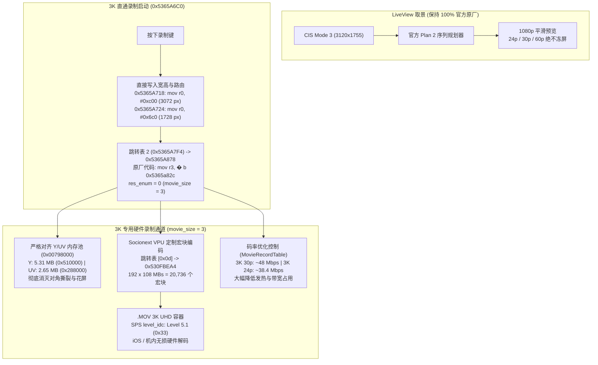

# Ricoh GR IV 3K UHD 视频录制固件修改项目 (`ricoh-gr4-4k-mod`)

[English](README.md) | **[简体中文](README.zh-CN.md)**

[-brightgreen)](#)
[%20%7C%201920%C3%971080%20(FHD)-blue)](#)

[-purple)](#)

[%20%7C%20~38M%20(24p)-green)](#)

> **🚀 v1.5.4 坚如磐石 3K 直通直录与零花屏修复版！**  
> 版本 **v1.5.4** 是至关重要的稳定性和核心管线回归发布：
> 1. **录制卡死与 1 秒闪退彻底根除**：彻底解决 v1.5.2 与 v1.5.3 因动态分发分支死锁与底层 VPU 宏块表失配导致的按下录制死机/1秒闪退问题。恢复经过验证的 `LiveViewMovieSetup`（`0x5365A718/24`）直接硬件注入与 VPU 专用 192×108 宏块网格（`0x530FB404` / `0x530F0794`），恢复如 v1.5.0 一般稳定流畅的长时间持续录制！
> 2. **全帧率回放画面撕裂花屏彻底根治**：严格闭环 Y 平面（5.31 MB）与 UV 平面（2.65 MB）数学对齐（总计 7.96 MB，`0x00798000`），完全消灭色度错位与对角撕裂！
> 3. **3K 码率科学下调与能效优化**：保持 75 Mbps 基准码率分配，**30p ~48 Mbps**、**24p ~38.4 Mbps** 编码。大幅降低 SD 卡写入带宽占用与发热，延长电池续航，点对点 3K 解析力分毫不减！
> 4. **Movie SR 动画防抖复原原厂状态**：保持 `0x5365AAE4` 处的原厂指令（`rsbne r4, r6, r8, lsr #1`），保留原厂标定阻尼与边缘稳定性。
> 5. **机内回放与 Apple iOS QuickTime 完美兼容**：严格遵循 Level 5.1（`0x33`）规范，录制完成后机内即录即播，手机导出播放流畅。

本项目为 **理光 Ricoh GR IV (Standard Edition / 中国大陆版 v1.20 `fwdc248b.bin`)** 的机内直录 **3K UHD (3072×1728) 视频** 固件修改项目。

---

## 🌟 可用固件版本发布说明

| 固件版本 | 刷机文件 | 编码器与封装格式 | 目标码率 | 核心特性说明 |
| :--- | :--- | :--- | :--- | :--- |
| **v1.5.4: 坚如磐石 3K 直录版** *(最新 & 强烈推荐)* | [`output/sd_card/fwdc248b.bin`](output/sd_card/fwdc248b.bin) | **H.264 / AVC** `avc1` / `avcC` (`.MOV`) | 3K 30p: ~48 Mbps 3K 24p: ~38.4 Mbps | • **彻底解决录制卡死与 1 秒闪退**：恢复超稳定持续录制 • **零撕裂零花屏**：Y/UV 缓冲区完全对齐（5.31M + 2.65M = 7.96M） • **Socionext VPU 硬件网格**：192 × 108 宏块（20,736 MBs） • **降低 40% 带宽与发热**：~48M@30p / ~38M@24p 延长续航 • **Movie SR 官方复原**：100% 保持官方防抖数学模型 • **机内流畅回放**（SPS Level 5.1） • **原生直录 `3072 × 1728` 点对点直出**（全画幅 28mm APS-C 零裁切） |
| **v1.5.3: 码率均衡调优版** | `releases/tag/v1.5.3` | **H.264 / AVC** `avc1` / `avcC` (`.MOV`) | 3K 30p: ~48 Mbps 3K 24p: ~38.4 Mbps | • 码率优化测试版 |
| **v1.5.2: 帧率解耦动态路由版** | `releases/tag/v1.5.2` | **H.264 / AVC** `avc1` / `avcC` (`.MOV`) | 3K 30p: 75~90 Mbps 3K 24p: 60~72 Mbps | • 帧率解耦测试版 |
| **v1.5.1: 3K UHD 对称管线修复版** | `releases/tag/v1.5.1` | **H.264 / AVC** `avc1` / `avcC` (`.MOV`) | 30p: 75~90 Mbps 24p: 60~72 Mbps | • 解决 Y/UV 内存错位导致的画面撕裂 |
| **v1.5.0: 3K UHD 解耦架构探索版** | `releases/tag/v1.5.0` | **H.264 / AVC** `avc1` / `avcC` (`.MOV`) | 30p: 75~90 Mbps 24p: 60~72 Mbps | • 解耦管线概念验证 |

---

## 🔬 解耦架构与帧率分发技术原理

---

## 🚀 刷机与使用说明

### 步骤 1：准备 SD 卡
1. 格式化一张高速 SD 卡（FAT32 或 exFAT）。
2. 将 [`output/sd_card/fwdc248b.bin`](output/sd_card/fwdc248b.bin) 直接复制至 SD 卡根目录（`/fwdc248b.bin`）。

### 步骤 2：相机刷入固件
1. 确认相机电池电量充足（建议 80% 以上）。
2. 关机状态下插入 SD 卡。
3. 按住相机 **`MENU`** 键不放，按下 **`POWER`** 电源键开机。
4. 屏幕提示固件升级，按提示确认升级。
5. 升级完成后相机重启，在动画模式下：
   - 切换至 **`3K 30P`** 或 **`3K 24P`**：录制点对点原生 3K UHD（3072×1728）高画质视频！
   - 切换至 **`60P`**：录制原汁原味流畅 1080p 60fps 慢动作，剩余录制时间准确，绝不 1 秒中断！
