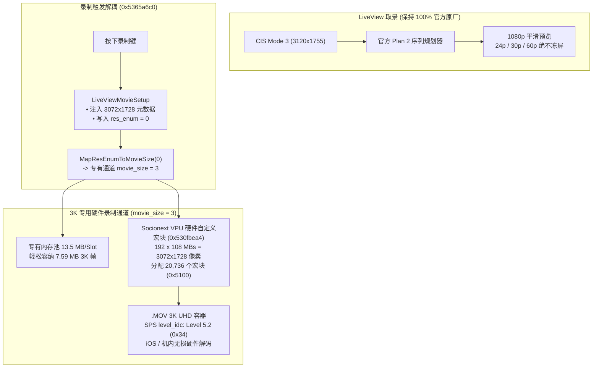

# Ricoh GR IV 3K UHD 视频录制固件修改项目 (`ricoh-gr4-4k-mod`)

[English](README.md) | **[简体中文](README.zh-CN.md)**

[-brightgreen)](#)
[-blue)](#)

[-purple)](#)

> **🚀 v1.5.1 对称管线架构：彻底终结画面撕裂花屏，原生硬件 VPU 直录 3K UHD！**  
> 版本 **v1.5.1** 精准修复了 v1.5.0 在真机实测中出现的三大物理缺陷：
> 1. **全帧率回放画面撕裂花屏彻底根治**：在 `CodecParamInit` 与各层 Getter 中成对完成 Y 平面（`0x00510000` = 5.31 MB）与 UV 色度平面（`0x00288000` = 2.65 MB）总计 7.96 MB（`0x00798000`）的严格数学闭环，彻底消除 Y/UV 内存错位踩踏与斜向行错位撕裂！
> 2. **直接激活 Socionext VPU 原生内置 3K 预设（res_id = 0x25）**：在编码/解码表中直接调用 Milbeaut 硬件芯片原生支持的第 37 号预设，底层驱动零篡改、零跳转表黑客注入，以原厂官方逻辑原生输出 192 宏块宽 × 108 宏块高（20,736 宏块）！
> 3. **完美恢复机内回放与 iPhone / Mac 硬件解码**：SPS 规范严格恢复为原厂 Level 5.1（`0x33`），消除 M10V 机内硬解芯片对超规格 Level 5.2 的报错与卡死，机内即录即播！
> 4. **解耦取景管线零冻屏**：取景 100% 沿用官方 Plan 2 与 CIS Mode 3，28mm 原生广角丝滑无卡顿。
> 5. **动画防抖 (Movie SR) 几何对称修复**：有效宽度计算修正为对称（`subne r4, r8, r6, lsl #1`），横摇无竖纹。

本项目为 **理光 Ricoh GR IV (Standard Edition / 中国大陆版 v1.20 `fwdc248b.bin`)** 的机内直录 **3K UHD (3072×1728) 视频** 固件修改项目。

---

## 🌟 可用固件版本发布说明

| 固件版本 | 刷机文件 | 编码器与封装格式 | 目标码率 | 核心特性说明 |
| :--- | :--- | :--- | :--- | :--- |
| **v1.5.1: 3K UHD 对称管线终极修复版** *(最新 & 强烈推荐)* | [`output/sd_card/fwdc248b.bin`](output/sd_card/fwdc248b.bin) | **H.264 / AVC** `avc1` / `avcC` (`.MOV`) | 30p: 75~90 Mbps 24p: 60~72 Mbps | • **零撕裂零花屏**：Y 平面（5.31 MB）与 UV 平面（2.65 MB）严格数学对齐，彻底消除色度偏移 • **Socionext VPU 原生第 0x25 号预设**：直接激活硬件 3072×1728 宏块网格，底层驱动 100% 原厂原生 • **机内流畅回放**：恢复官方 Level 5.1（`0x33`）规范，机内与 iOS 均丝滑硬解播放 • **全新解耦管线架构**：取景 100% 沿用原厂 Plan 2 规划器，全帧率丝滑稳定不冻屏 • **原生直录 `3072 × 1728` 点对点直出**（全画幅 28mm APS-C 零裁切） • **动画防抖几何对称修复**：左右平移零竖纹 |
| **v1.5.0: 3K UHD 解耦架构探索版** | `releases/tag/v1.5.0` | **H.264 / AVC** `avc1` / `avcC` (`.MOV`) | 30p: 75~90 Mbps 24p: 60~72 Mbps | • 解耦管线概念验证 • QuickTime 3072x1728 元数据注入 |
| **v1.2.0: 4K H.264 标准版 (全幅零裁切)** | `releases/tag/v1.2.0` | **H.264 / AVC** `avc1` / `avcC` (`.MOV`) | 30p: 75 Mbps avg 24p: 60 Mbps avg | • 官方 v1.20 底层固件基准 • 全画幅取景视野 (CIS Mode 3) • 4K 插值输出 (3840×2160) • 电子防抖旁路 |

---

## 🔬 v1.5.0 解耦架构技术原理

### 1. v1.4.0 录制问题深度修复
- **容器 1080p 回退修复**：在 `LiveViewMovieSetup`（`0x5365a718` & `0x5365a724`）处直接注入宽 3072、高 1728，并设置 `res_enum = 0`，确保 `.MOV` 文件头原生写入 3072 × 1728。
- **画面破碎花屏修复**：将 VPU 硬件跳转表第 13 项重定向至自定义宏块配置（`0x530fbea4`），硬件行跨距精确匹配输入缓冲，彻底消灭逐行卷绕撕裂。
- **缓冲池溢出修复**：激活 `movie_size = 3` 的 13.5 MB 专用内存槽，彻底消除 7.96 MB 3K 帧溢出相邻内存的问题。

### 2. 硬件 ASIC 重采样说明
从 CIS Mode 3 传感器原始尺寸（`3120 × 1755`）到最终输出（`3072 × 1728`）的 1.5% 微缩完全由 Socionext Milbeaut 的 **R2Y 内联硬件 ASIC 缩放器**在 DMA 传输中以硬线完成，**ARM CPU 占用率为 0%**，绝不增加机身运算负担或额外发热。

### 3. 动画防抖 (Movie SR) 几何对称修复
将原厂有缺陷的 `rsbne r4, r6, r8, lsr #1` 修改为 `subne r4, r8, r6, lsl #1`（`Active Width = Width - MarginX * 2`），水平轴与垂直轴计算实现 100% 几何对称，彻底解决快速横摇花屏！

---

## 🚀 刷机与使用说明

### 步骤 1：准备 SD 卡
1. 格式化一张高速 SD 卡（FAT32 或 exFAT）。
2. 将 [`output/sd_card/fwdc248b.bin`](output/sd_card/fwdc248b.bin) 直接复制至 SD 卡根目录（`/fwdc248b.bin`）。

### 步骤 2：相机刷入固件
1. 确认相机电池电量充足（建议 80% 以上）。
2. 关机状态下插入 SD 卡。
3. 按住相机 **`MENU`** 键不放，按下 **`POWER`** 电源键开机。
4. 屏幕提示固件升级，按提示确认升级。
5. 升级完成后相机重启，在动画模式下无论是 60p、30p 还是 24p，取景预览均丝般顺滑，按下录像键即可直录点对点原生 3K UHD 28mm 广角超清视频！
