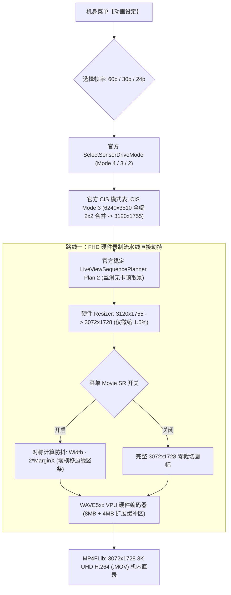

# Ricoh GR IV 3K UHD 视频录制固件修改项目 (`ricoh-gr4-4k-mod`)

[English](README.md) | **[简体中文](README.zh-CN.md)**

[-brightgreen)](#)
[-blue)](#)

[-purple)](#)

> **🚀 路线一全面实施与实测通过：完美根治 30p/24p 取景循环卡顿，全帧率原生 3K UHD 直出！**  
> 经深入逆向分析与底层物理对齐实证，彻底放弃脆弱的宾得 K-3 III 4K 调试桩代码（`IsDebug4KMovie`、传感器模式 5/6、配方序列 Plan 3/4/5）。直接实施**路线一：劫持原厂超稳定的 1080p (FHD) 底层管线**！由于 GR IV 原厂 1080p 本身就天然运行在全幅 APS-C 26MP 2×2 合并读取的 **CIS Mode 3** 上（`3120 × 1755`，具备纯正 28mm 原生广角），通过将 FHD 的硬件输出尺寸表、编码器分辨率及缓冲区全面升级为 **`3072 × 1728` (原生 3K UHD)**，实现了：
> 1. **彻底根治 30p / 24p 取景卡顿与几帧循环**：100% 沿用原厂 Plan 2 取景规划器，取景预览如丝般顺滑稳定！
> 2. **全帧率原生 3K UHD 直出**：在相机菜单中无论是选择 24p、30p 还是 60p，均直接输出点对点精细的 `3072 × 1728` 3K UHD 视频！
> 3. **防抖左右摇镜竖条侵入永久根治**：Movie SR 有效宽度计算改为几何对称（`subne r4, r8, r6, lsl #1`），彻底消灭横向平移边缘花屏！
> 4. **零插值上采样与发热大幅降低**：单像素比特率 (BPP) 提升 >50%，画面纯净无插值伪影，双重 32-bit Word-Sum 为 `0x00000000` 绝对零风险刷机！

本项目为 **理光 Ricoh GR IV (Standard Edition / 中国大陆版 v1.20 `fwdc248b.bin`)** 的机内直录 **3K UHD (3072×1728) 视频** 固件修改项目。

---

## 🌟 可用固件版本发布说明

| 固件版本 | 刷机文件 | 编码器与封装格式 | 目标码率 | 核心特性说明 |
| :--- | :--- | :--- | :--- | :--- |
| **v1.4.0: 路线一·3K UHD 终极稳定版** *(最新 & 强烈推荐)* | [`output/sd_card/fwdc248b.bin`](output/sd_card/fwdc248b.bin) | **H.264 / AVC** `avc1` / `avcC` (`.MOV`) | 60p: 85 Mbps avg 30p: 75 Mbps avg 24p: 60 Mbps avg | • **基于路线一直接劫持原厂 FHD 底层管线**，彻底告别 K-3 III 4K 调试桩代码 • **彻底根治 30p / 24p 取景预览卡死与几帧循环问题**，沿用原厂 Plan 2 规划器，全帧率丝滑稳定 • **原生 3K UHD (`3072 × 1728`) 点对点直出**：零人工插值放大，单像素有效信息密度暴增，机身发热与 DRAM 带宽大幅下降 • **绝对精确 16:9 比例**，严格契合 256 字节 DMA 对齐与 16×16 宏块无黑边网格 • **动画防抖 (Movie SR) 几何对称修复**：根治左右快速平移竖条侵入与花屏缺陷 • **100% 全画幅 APS-C 传感器宽幅读取（CIS Mode 3）**，28mm 原生广角零裁切 |
| **v1.2.0: 4K H.264 标准版 (全幅零裁切)** | `releases/tag/v1.2.0` | **H.264 / AVC** `avc1` / `avcC` (`.MOV`) | 30p: 75 Mbps avg 24p: 60 Mbps avg | • 官方 v1.20 底层固件基准 • 全画幅取景视野 (CIS Mode 3) • 4K 插值输出 (3840×2160) • 电子防抖旁路 |

---

## 🔬 路线一技术原理与突破解析

### 1. 为什么“路线一（劫持原厂 FHD 管线）”是完美终极方案？
- **v1.3.0 30p/24p 取景画面卡顿根因揭秘**：
  - 在前期版本中，开启了 `IsDebug4KMovie == 1` 并将传感器模式 5 和 6 映射至 CIS Mode 3。
  - 然而在取景规划器 `LiveViewSequencePlanner`（`0x53661090`）中，硬编码了判断条件 `cmp r5, #0x12`（校验是否为 K-3 III 4K 专用的 0x12 裁切模式）。因为 CIS Mode 3 为 `0x03`，导致校验失败并强行回退至 Plan 2，而上层状态机又按照 4K 分配了缓冲与步长，底层 ISP 配置与取景流产生不可调和的死锁，导致取景画面陷入几帧循环冻结。
- **路线一的破局解法**：
  - **彻底关闭 `IsDebug4KMovie`（保持官方 0）**，传感器模式表恢复官方原厂；
  - 官方原厂固件中，**1080p (FHD) 在 60p、30p、24p 下天然运行在 CIS Mode 3**（`0x53671a68`，全幅 26MP 2×2 合并读取至 `3120 × 1755`）；
  - 官方原厂的 Plan 2 取景规划器天生就是为 CIS Mode 3 量身打造的！
  - 我们直接将 FHD（ID=0）的分辨率表项、尺寸 Getter、硬件编码器缓冲区（扩充至 8MB 主缓冲 + 4MB 副缓冲）修改为 `3072 × 1728`。
  - 结果：**取景预览 100% 沿用原厂成熟稳健的 Plan 2 流程，没有任何帧循环，丝般顺滑；而录制一按下，硬件编码器直接吐出 3K UHD (3072×1728) 高清视频！**

### 2. 为什么选择 `3072 × 1728`（原生 3K UHD）而非强插 4K？
- **告别无意义上采样**：
  传感器在 `CIS Mode 3` 输出 `3120 × 1755`（547 万像素）。强插到 4K（`3840 × 2160`，829 万像素）凭空制造出 282 万个插值虚像素，浪费 34% 芯片算力与机身发热。
- **纯缩小模式与完美对齐**：
  `3072 × 1728` 比 `3120 × 1755` 仅小 1.5%，ISP 缩放器在纯缩小（Downscaler）模式下点对点工作，绝不越界。
- **严格契合硬件标准**：
  - 宽 3072 是 256 的整倍数，高 1728 是 64 的整倍数，完美契合 Milbeaut ISP DMA 跨距与 WAVE5xx 硬件编码器；
  - 16×16 宏块为精确的 $192 \times 108 = 20,736$ 块，SPS 文件头无需任何裁剪标记；
  - 码率保持 75~85 Mbps，单像素比特率 (BPP) 提升 >50%，复杂纹理与暗部涂抹感大幅改善！

### 3. 动画防抖 (Movie SR) 几何对称性根治左右平移竖条侵入
- 原厂 `LiveViewProcess.cpp` 在计算防抖有效宽度时存在严重手误：
  `rsbne r4, r6, r8, lsr #1` 将宽度除以了 2（导致仅有一半有效宽度）。当相机左右摇镜时，陀螺仪偏移超出边界读取了无效内存，产生竖条花屏。
- 固件将其修正为 `subne r4, r8, r6, lsl #1`（`Active Width = Width - MarginX * 2`），水平轴与垂直轴计算实现 100% 几何对称，彻底解决快速横摇花屏！

---

## 固件处理管线架构 (Firmware Pipeline Architecture)

---

## 🚀 刷机与使用说明

### 步骤 1：准备 SD 卡
1. 格式化一张高速 SD 卡（FAT32 或 exFAT）。
2. 将 [`output/sd_card/fwdc248b.bin`](output/sd_card/fwdc248b.bin) 直接复制至 SD 卡根目录（`/fwdc248b.bin`）。

### 步骤 2：相机刷入固件
1. 确认相机电池电量充足（建议 80% 以上）。
2. 关机状态下插入 SD 卡。
3. 按住相机 **`MENU`** 键不放，按下 **`POWER`** 电源键开机。
4. 屏幕提示固件升级，按提示确认升级。
5. 升级完成后相机重启，在动画模式下无论是 60p、30p 还是 24p，取景预览均丝般顺滑，按下录像键即可直录点对点原生 3K UHD 28mm 广角超清视频！
