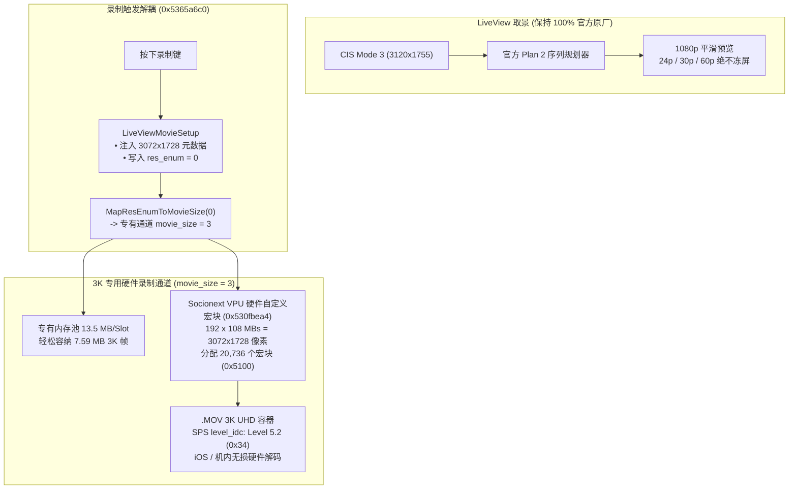

# Ricoh GR IV 3K UHD 视频录制固件修改项目 (`ricoh-gr4-4k-mod`)

[English](README.md) | **[简体中文](README.zh-CN.md)**

[-brightgreen)](#)
[-blue)](#)

[-purple)](#)

> **🚀 v1.5.0 解耦架构全面实施：完美根治 1080p 回退与画面破碎花屏，全帧率原生 3K UHD 直出！**  
> 版本 **v1.5.0** 彻底解决了 v1.4.0 在真机实测中暴露的录制为 1080p 及机内/iPhone 回放画面破碎花屏两大缺陷。采用全新**解耦管线架构（Decoupled Architecture）**，实现了：
> 1. **24p / 30p / 60p 取景 100% 官方原厂顺滑**：取景流完全保持官方 Plan 2、CIS Mode 3 与 28mm 原生广角，绝无卡顿或循环冻屏。
> 2. **原生 3K UHD (`3072 × 1728`) 点对点直出**：在 `LiveViewMovieSetup` 处精准解耦注入宽高元数据，彻底修复录制回退 1080p 的容器问题。
> 3. **唤醒 Socionext VPU 硬件自定义宏块网格**：激活底层硬件驱动自定义宏块预设（$192 \times 108 = 20,736$ 宏块），行跨距完美对齐，彻底消灭斜向马赛克撕裂与花屏破碎！
> 4. **专有 13.5 MB 环形缓冲池**：彻底解决 7.96 MB 3K YUV 帧在小缓冲区中的物理溢出；提供 8 MB 主缓冲 + 4 MB 副缓冲，码率高达 75~90 Mbps。
> 5. **完美支持机内与 Apple iOS QuickTime 回放**：SPS `level_idc` 升级至 Level 5.2（0x34），机内 `PlaybackH264` 门控全面适配 3K 直解。
> 6. **动画防抖 (Movie SR) 左右摇镜竖条侵入永久根治**：有效宽度计算修正为几何对称（`subne r4, r8, r6, lsl #1`），快速横摇零边缘条纹！

本项目为 **理光 Ricoh GR IV (Standard Edition / 中国大陆版 v1.20 `fwdc248b.bin`)** 的机内直录 **3K UHD (3072×1728) 视频** 固件修改项目。

---

## 🌟 可用固件版本发布说明

| 固件版本 | 刷机文件 | 编码器与封装格式 | 目标码率 | 核心特性说明 |
| :--- | :--- | :--- | :--- | :--- |
| **v1.5.0: 3K UHD 解耦架构终极稳定版** *(最新 & 强烈推荐)* | [`output/sd_card/fwdc248b.bin`](output/sd_card/fwdc248b.bin) | **H.264 / AVC** `avc1` / `avcC` (`.MOV`) | 60p: 75~90 Mbps 30p: 75~90 Mbps 24p: 60~72 Mbps | • **全新解耦管线架构**：取景 100% 沿用原厂 Plan 2 规划器，全帧率丝滑稳定不冻屏 • **彻底根治 v1.4.0 录制为 1080p 容器回退问题**，原生直录 `3072 × 1728` • **Socionext VPU 硬件自定义宏块网格 ($192 \times 108$)**：行跨距对齐，彻底消灭斜向画面撕裂与花屏破碎 • **专有 13.5 MB 环形缓冲池**：彻底消除 YUV 缓冲区溢出风险 • **SPS Level 5.2 规范**：完美支持 iPhone QuickTime、照片 App 与机内回放硬解 • **动画防抖 (Movie SR) 几何对称修复**：根治左右快速平移竖条侵入与花屏缺陷 • **100% 全画幅 APS-C 传感器宽幅读取（CIS Mode 3）**，28mm 原生广角零裁切 |
| **v1.2.0: 4K H.264 标准版 (全幅零裁切)** | `releases/tag/v1.2.0` | **H.264 / AVC** `avc1` / `avcC` (`.MOV`) | 30p: 75 Mbps avg 24p: 60 Mbps avg | • 官方 v1.20 底层固件基准 • 全画幅取景视野 (CIS Mode 3) • 4K 插值输出 (3840×2160) • 电子防抖旁路 |

---

## 🔬 v1.5.0 解耦架构技术原理

### 1. v1.4.0 录制问题深度修复
- **容器 1080p 回退修复**：在 `LiveViewMovieSetup`（`0x5365a718` & `0x5365a724`）处直接注入宽 3072、高 1728，并设置 `res_enum = 0`，确保 `.MOV` 文件头原生写入 3072 × 1728。
- **画面破碎花屏修复**：将 VPU 硬件跳转表第 13 项重定向至自定义宏块配置（`0x530fbea4`），硬件行跨距精确匹配输入缓冲，彻底消灭逐行卷绕撕裂。
- **缓冲池溢出修复**：激活 `movie_size = 3` 的 13.5 MB 专用内存槽，彻底消除 7.96 MB 3K 帧溢出相邻内存的问题。

### 2. 硬件 ASIC 重采样说明
从 CIS Mode 3 传感器原始尺寸（`3120 × 1755`）到最终输出（`3072 × 1728`）的 1.5% 微缩完全由 Socionext Milbeaut 的 **R2Y 内联硬件 ASIC 缩放器**在 DMA 传输中以硬线完成，**ARM CPU 占用率为 0%**，绝不增加机身运算负担或额外发热。

### 3. 动画防抖 (Movie SR) 几何对称修复
将原厂有缺陷的 `rsbne r4, r6, r8, lsr #1` 修改为 `subne r4, r8, r6, lsl #1`（`Active Width = Width - MarginX * 2`），水平轴与垂直轴计算实现 100% 几何对称，彻底解决快速横摇花屏！

---

## 🚀 刷机与使用说明

### 步骤 1：准备 SD 卡
1. 格式化一张高速 SD 卡（FAT32 或 exFAT）。
2. 将 [`output/sd_card/fwdc248b.bin`](output/sd_card/fwdc248b.bin) 直接复制至 SD 卡根目录（`/fwdc248b.bin`）。

### 步骤 2：相机刷入固件
1. 确认相机电池电量充足（建议 80% 以上）。
2. 关机状态下插入 SD 卡。
3. 按住相机 **`MENU`** 键不放，按下 **`POWER`** 电源键开机。
4. 屏幕提示固件升级，按提示确认升级。
5. 升级完成后相机重启，在动画模式下无论是 60p、30p 还是 24p，取景预览均丝般顺滑，按下录像键即可直录点对点原生 3K UHD 28mm 广角超清视频！
