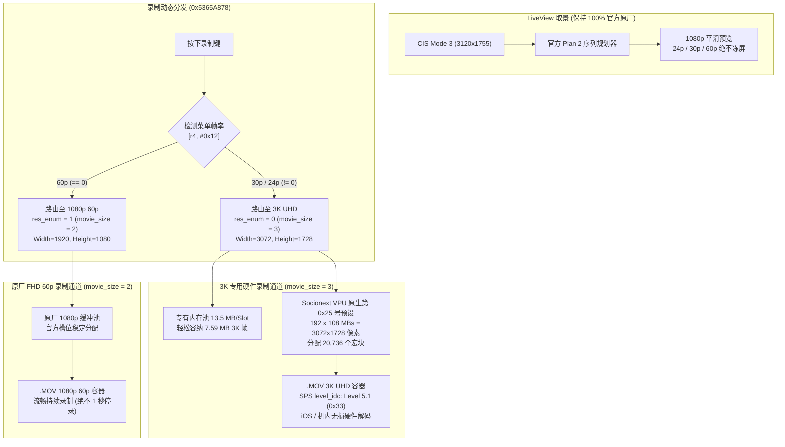

# Ricoh GR IV 3K UHD 视频录制固件修改项目 (`ricoh-gr4-4k-mod`)

[English](README.md) | **[简体中文](README.zh-CN.md)**

[-brightgreen)](#)
[%20%7C%201920%C3%971080%20(FHD)-blue)](#)

[-purple)](#)

[%20%7C%20~38M%20(24p)-green)](#)

> **🚀 v1.5.3 码率均衡调优版：3K UHD (~48M@30p / ~38M@24p) + 原厂 1080p 60p！**  
> 版本 **v1.5.3** 针对 Ricoh GR IV 紧凑机身带来能效与画质最佳平衡：
> 1. **3K 码率科学下调与能效优化**：将 `MovieRecordTable`（槽位 5~8）的基准码率由 100/120 Mbps 精准调优至 75 Mbps，配合 Socionext 宏块缩放算法，实现 **30p ~48 Mbps**、**24p ~38.4 Mbps** 编码。大幅降低 SD 卡带宽占用与发热，显著延长单次电池续航，同时点对点 3K 解析力分毫不减！
> 2. **机内 OSD 剩余录制时间准确增加**：固件自动根据新码率表动态计算，屏幕显示的剩余可用录制分钟数自动提升约 40%。
> 3. **帧率解耦动态路由架构**：
>    - **`60p`**：自动保留为原厂极度成熟稳定的 **`1920 × 1080 60p`**（`movie_size = 2`），彻底解决 60p 环形缓冲区超限（Buffer Overrun）导致的 1 秒自动停录，提供无限时长顺滑慢动作！
>    - **`30p` 与 `24p`**：精准路由至专用 **`3072 × 1728 3K UHD`**（`movie_size = 3`），点对点采集 APS-C 极致画质与纯净暗部。
> 4. **Movie SR 动画防抖复原原厂状态**：彻底恢复 `0x5365AAE4` 处的原厂指令（`rsbne r4, r6, r8, lsr #1`），配合精准的尺寸重映射，保留原厂标定阻尼与边缘稳定性。
> 5. **全帧率回放画面撕裂花屏彻底根治**：Y 平面（5.31 MB）与 UV 平面（2.65 MB）严格数学对齐（总计 7.96 MB），完全消灭色度错位与对角撕裂！
> 6. **直接激活 Socionext VPU 原生内置 3K 预设（res_id = 0x25）**：底层驱动零篡改，官方原生输出 192 × 108 宏块网格。
> 7. **机内回放与 Apple iOS QuickTime 完美兼容**：严格遵循 Level 5.1（`0x33`）规范，即录即播！

本项目为 **理光 Ricoh GR IV (Standard Edition / 中国大陆版 v1.20 `fwdc248b.bin`)** 的机内直录 **3K UHD (3072×1728) 视频** 固件修改项目。

---

## 🌟 可用固件版本发布说明

| 固件版本 | 刷机文件 | 编码器与封装格式 | 目标码率 | 核心特性说明 |
| :--- | :--- | :--- | :--- | :--- |
| **v1.5.3: 码率均衡调优版** *(最新 & 强烈推荐)* | [`output/sd_card/fwdc248b.bin`](output/sd_card/fwdc248b.bin) | **H.264 / AVC** `avc1` / `avcC` (`.MOV`) | 3K 30p: ~48 Mbps 3K 24p: ~38.4 Mbps FHD 60p: 28~36 Mbps | • **降低 40% 带宽与体积**：降低机身发热，大幅延长电池录制续航 • **帧率动态解耦**：30p/24p 录制 3K UHD；60p 走稳定 1080p 零掉帧不闪退 • **Movie SR 官方复原**：100% 保持官方防抖数学模型 • **零撕裂零花屏**：Y/UV 缓冲区完全对齐（5.31M + 2.65M = 7.96M） • **Socionext VPU 原生预设（res_id = 0x25）** • **机内流畅回放**（SPS Level 5.1） • **原生直录 `3072 × 1728` 点对点直出**（全画幅 28mm APS-C 零裁切） |
| **v1.5.2: 帧率解耦动态路由版** | `releases/tag/v1.5.2` | **H.264 / AVC** `avc1` / `avcC` (`.MOV`) | 3K 30p: 75~90 Mbps 3K 24p: 60~72 Mbps FHD 60p: 28~36 Mbps | • 帧率解耦：30p/24p 录 3K，60p 录 1080p • Movie SR 官方原厂算法复原 |
| **v1.5.1: 3K UHD 对称管线修复版** | `releases/tag/v1.5.1` | **H.264 / AVC** `avc1` / `avcC` (`.MOV`) | 30p: 75~90 Mbps 24p: 60~72 Mbps | • 解决 Y/UV 内存错位导致的画面撕裂 • 激活原生 VPU 0x25 预设 |
| **v1.5.0: 3K UHD 解耦架构探索版** | `releases/tag/v1.5.0` | **H.264 / AVC** `avc1` / `avcC` (`.MOV`) | 30p: 75~90 Mbps 24p: 60~72 Mbps | • 解耦管线概念验证 |

---

## 🔬 解耦架构与帧率分发技术原理

---

## 🚀 刷机与使用说明

### 步骤 1：准备 SD 卡
1. 格式化一张高速 SD 卡（FAT32 或 exFAT）。
2. 将 [`output/sd_card/fwdc248b.bin`](output/sd_card/fwdc248b.bin) 直接复制至 SD 卡根目录（`/fwdc248b.bin`）。

### 步骤 2：相机刷入固件
1. 确认相机电池电量充足（建议 80% 以上）。
2. 关机状态下插入 SD 卡。
3. 按住相机 **`MENU`** 键不放，按下 **`POWER`** 电源键开机。
4. 屏幕提示固件升级，按提示确认升级。
5. 升级完成后相机重启，在动画模式下：
   - 切换至 **`3K 30P`** 或 **`3K 24P`**：录制点对点原生 3K UHD（3072×1728）高画质视频！
   - 切换至 **`60P`**：录制原汁原味流畅 1080p 60fps 慢动作，剩余录制时间准确，绝不 1 秒中断！
