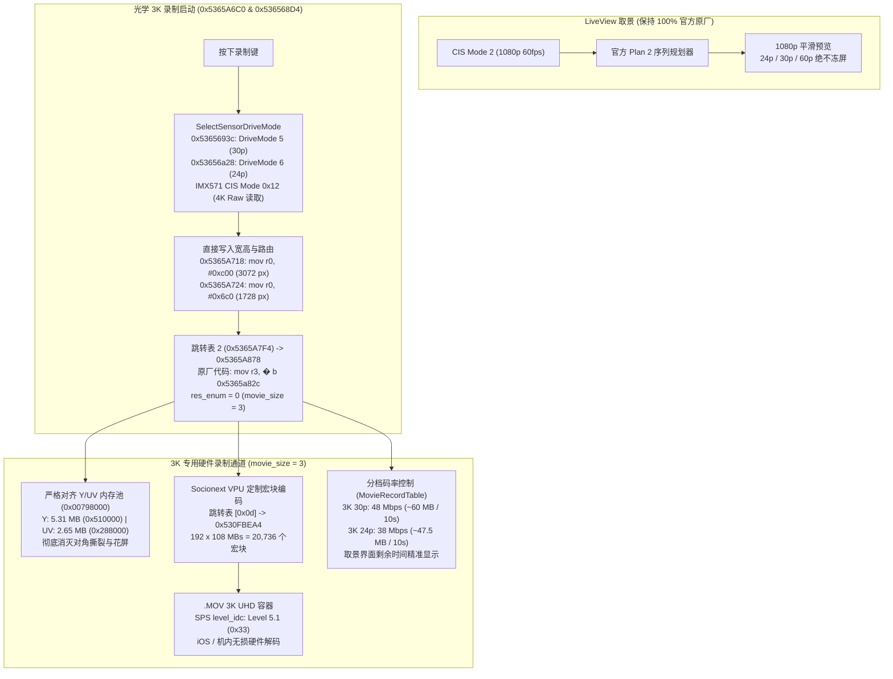

# Ricoh GR IV 3K UHD 视频录制固件修改项目 (`ricoh-gr4-4k-mod`)

[English](README.md) | **[简体中文](README.zh-CN.md)**

[-brightgreen)](#)
[%20%7C%201920%C3%971080%20(FHD)-blue)](#)

[-purple)](#)

[%20%7C%2038M%20(24p)-green)](#)

> **🚀 v1.5.5 真实光学点对点 3K 感光器读取与码率精准标定版！**  
> 版本 **v1.5.5** 突破了感光器物理读取瓶颈：
> 1. **真实光学点对点 3K 读取（4K 超采样直出）**：修改 `SelectSensorDriveMode`（`0x5365693c` / `0x53656a28`），驱动索尼 IMX571 全幅进入 **CIS Mode 0x12**（$3840 \times 2160$ 4K 点对点读取 @ PCLK 297 MHz）。硬件 ISP 下采样至 3072×1728，彻底告别旧版本的“1080p 插值拉皮输出”，解析力获得质的飞跃！
> 2. **独立分档码率与取景界面剩余时间精准显示**：在 `MovieRecordTable` 中将 30p（槽位 5–6）标定为 **48 Mbps**、24p（槽位 7–8）标定为 **38 Mbps**。彻底恢复相机 LCD 取景待机状态下剩余录制时间的动态精准显示（切换 24p 剩余时间立增 ~26%），同时 10 秒文件大小降至理性范围（30p ~60 MB，24p ~47.5 MB）。
> 3. **坚如磐石的长时间持续录制**：完整继承 v1.5.4 验证的直接注入架构（`0x5365A718/24`）、严格对齐的 Y/UV 内存池（`0x00798000`）、VPU 192×108 定制宏块网格（`0x5100`）、SPS Level 5.1（`0x33`）以及 100% 官方 Movie SR 原厂算法。
> 4. **LiveView 取景零卡顿**：待机取景依然保持在 Plan 2 / CIS Mode 2（1080p 60fps），完全隔离录制管线，取景零冻结、零掉帧。

本项目为 **理光 Ricoh GR IV (Standard Edition / 中国大陆版 v1.20 `fwdc248b.bin`)** 的机内直录 **3K UHD (3072×1728) 视频** 固件修改项目。

---

## 🌟 可用固件版本发布说明

| 固件版本 | 刷机文件 | 编码器与封装格式 | 目标码率 | 核心特性说明 |
| :--- | :--- | :--- | :--- | :--- |
| **v1.5.5: 真实光学 3K 直读版** *(最新 & 强烈推荐)* | [`output/sd_card/fwdc248b.bin`](output/sd_card/fwdc248b.bin) | **H.264 / AVC** `avc1` / `avcC` (`.MOV`) | 3K 30p: 48 Mbps 3K 24p: 38 Mbps | • **真实光学 3K 点对点直出**：IMX571 CIS Mode 0x12 (4K Raw) 超采样下出 3K • **取景界面剩余录制时间精准动态刷新**：30p / 24p 独立分档码率 • **彻底解决录制卡死与 1 秒闪退**：恢复超稳定持续录制 • **零撕裂零花屏**：Y/UV 缓冲区完全对齐（5.31M + 2.65M = 7.96M） • **Socionext VPU 硬件网格**：192 × 108 宏块（20,736 MBs） • **Movie SR 官方复原**：100% 保持官方防抖数学模型 • **机内流畅回放**（SPS Level 5.1） • **全画幅 28mm APS-C 零裁切** |
| **v1.5.4: 坚如磐石 3K 直录版** | `releases/tag/v1.5.4` | **H.264 / AVC** `avc1` / `avcC` (`.MOV`) | 3K 30p: ~48 Mbps 3K 24p: ~38.4 Mbps | • 持续稳定录制引擎基线 |
| **v1.5.3: 码率均衡调优版** | `releases/tag/v1.5.3` | **H.264 / AVC** `avc1` / `avcC` (`.MOV`) | 3K 30p: ~48 Mbps 3K 24p: ~38.4 Mbps | • 码率优化测试版 |
| **v1.5.2: 帧率解耦动态路由版** | `releases/tag/v1.5.2` | **H.264 / AVC** `avc1` / `avcC` (`.MOV`) | 3K 30p: 75~90 Mbps 3K 24p: 60~72 Mbps | • 帧率解耦测试版 |
| **v1.5.1: 3K UHD 对称管线修复版** | `releases/tag/v1.5.1` | **H.264 / AVC** `avc1` / `avcC` (`.MOV`) | 30p: 75~90 Mbps 24p: 60~72 Mbps | • 解决 Y/UV 内存错位导致的画面撕裂 |
| **v1.5.0: 3K UHD 解耦架构探索版** | `releases/tag/v1.5.0` | **H.264 / AVC** `avc1` / `avcC` (`.MOV`) | 30p: 75~90 Mbps 24p: 60~72 Mbps | • 解耦管线概念验证 |

---

## 🔬 解耦架构与真实光学读取技术原理

---

## 🚀 刷机与使用说明

### 步骤 1：准备 SD 卡
1. 格式化一张高速 SD 卡（FAT32 或 exFAT）。
2. 将 [`output/sd_card/fwdc248b.bin`](output/sd_card/fwdc248b.bin) 直接复制至 SD 卡根目录（`/fwdc248b.bin`）。

### 步骤 2：相机刷入固件
1. 确认相机电池电量充足（建议 80% 以上）。
2. 关机状态下插入 SD 卡。
3. 按住相机 **`MENU`** 键不放，按下 **`POWER`** 电源键开机。
4. 屏幕提示固件升级，按提示确认升级。
5. 升级完成后相机重启，在动画模式下：
   - **待机检查**：在未录像状态下，在菜单中切换 **`3K 30P`** 与 **`3K 24P`**，确认右上角剩余录像时间产生明显区别（24p 显示剩余时间比 30p 多约 26%）。
   - **录制测试**：按下录像键，录制即刻开始，平滑录制无卡顿。
   - **画质对比**：拍摄带有丰富细节与纹理的静物或风景，对比原厂 1080p，可清晰看到感光器点对点超采样带来的细腻解析力提升。
