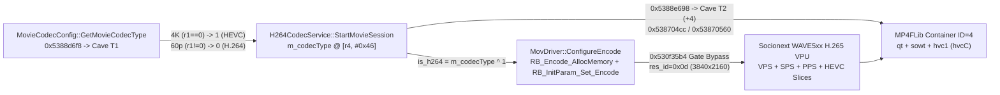

# Ricoh GR IV v1.11 4K Video Mod Specification (Route B: K-3 Mark III Parity 4K H.264 & WAVE5xx 4K HEVC)

## 1. 概述 (Executive Summary)

本分支（`feat/4k-k3-hevc`）基于对 **Ricoh GR IV (`fwdc248b.bin` v1.11)**、**Pentax K-3 Mark III** 与 **GoPro GP2 (Socionext Milbeaut WAVE5xx)** 固件的完整逆向对齐，采用最小侵入式 **路线 B** 分两步实现原生 4K 视频录制：

1. **Step 1 — Pentax K-3 Mark III 同级原生 4K H.264（`output/fwdc248b.bin`）**
   - **帧率映射**：菜单选择 `30p` / `24p` 时自动启用原生 **4K UHD (`3840×2160`, `avc1`/`avcC`)** 录制（30p 平均 75 Mbps / 峰值 90 Mbps；24p 平均 60 Mbps / 峰值 72 Mbps）；选择 `60p` 保持原生 **1080p60 FHD (`1920×1080`)**。
   - **真 4K 超采传感器读出**：激活原生 `SensorMode 0x12`（`4592×2584` 读出硬件缩放至 `3840×2160`），非 1080p 插值放大。
   - **零冻屏取景与全平台回放**：修复 GR IV 遗留的 3 处 K-3 III 4K LiveView 对齐缺陷（Defect A/B/C），完整保留机内回放（`PlaybackH264Process`）、iPhone Air (iOS QuickTime) 与 Windows 原生播放兼容性。
   - **极致手术隔离**：全固件 67.95 MB 解码载荷实际仅变动 **11 字节**（6 处原位补丁窗口共 28 字节），零代码洞依赖。

2. **Step 2 — Socionext Milbeaut WAVE5xx 原生 4K HEVC / H.265（`output/fwdc248b_4k_hevc.bin`）**
   - 在 Step 1 基础上唤醒 GR IV RTOS 内置的 Socionext Milbeaut **WAVE5xx 硬件 H.265 编解码器**（`RiberyM9M_Codec/FUNC/Movie/H265/WAVE`）与 `MP4FLib` 原生 **`qt + sowt + hvc1` (`hvcC`)** 封装路径。
   - `30p` / `24p` 输出符合 Apple QuickTime 标准的 **`3840×2160` `hvc1` (`hvcC` 含硬件生成 VPS/SPS/PPS)** `.MOV`；`60p` 保持 `1080p60` H.264 (`avc1`)。

---

## 2. 早期方案问题根因复盘 (Root-Cause Diagnosis)

对比本分支早期草稿（`7658e91`）与官方 `05_RTOS.bin` 反汇编，确认了此前导致取景异常、封装错位及**机内无法回放**的四大根因：

1. **误改 `0x5375cba4` (`GetMovieFrameRate`)**：该函数读取 `[r3, #0x7e1]`（`0`=60p, `1`=30p, `2`=24p），强行覆盖为布尔返回值会破坏全局帧率状态机。
2. **误改 `0x538924dc` (`R2yPipeService::SetupMacro`)**：该函数实为 ISP R2Y DMA 宏初始化而非 MOV 封装模板。`MP4FLib` 的 `tkhd` 与 `stsd` 宽高及 `avcC`/`hvcC` 均直接取自硬件编码器码流头，无需手工篡改内存偏移。
3. **误改 `0x5388e144` (`H264CodecService::StartDecodeSession`) 导致机内回放损坏**：`0x5388e0f4` 仅由 `PlaybackH264Process.cpp` (`0x536c3ed4`) 调用用于**机内视频回放**！官方固件在 `0x536c34e4` 已原生支持识别 `3840×2160` (`r6=0`) 并分配 `12.53 MB` (`0x00BF4000`) 4K 解码缓冲，且将分辨率枚举存入 `[r5, #0x1c]`。此前将 `0x5388e144` 改为读取帧率字段直接破坏了机内回放！保持 `0x5388e144` 原厂未动即可完美支持机内 4K 与 1080p 回放。
4. **遗漏 K-3 III 移植到 GR IV 时的 3 处 LiveView 4K 缺陷**：见下节 Defect A / B / C。

---

## 3. Step 1 补丁清单：Pentax K-3 III 同级 4K H.264 (`output/fwdc248b.bin`)

| 补丁 ID | 虚拟地址 | 长度 | 原厂字节 $\rightarrow$ 补丁字节 | 功能说明 |
| :--- | :--- | :---: | :--- | :--- |
| `is_debug_4k_movie_enable` | `0x53885bf0` | 8B | `0000a0e3 1eff2fe1` $\rightarrow$ `0100a0e3 1eff2fe1` | `LiveViewDebug::IsDebug4KMovie` 返回 `1`，自动打通 4K 传感器模式 `0x12`、`MovieStartParam[+0x1c]`、VPU 4K 缓冲与 `MP4FLib` |
| `lv_defect_a_cmp_60p` | `0x5362e508` | 4B | `010050e3` $\rightarrow$ `000050e3` | Defect A：`cmp r0, #0`（检测 `60p == 0`，避免 `24p == 2` 误入 FHD 分支） |
| `lv_defect_a_beq_fhd` | `0x5362e510` | 4B | `d9ffff1a` $\rightarrow$ `d9ffff0a` | Defect A：`beq 0x5362e47c`（仅 `60p` 走 FHD 取景缓冲，`30p`/`24p` 均走 4K 取景） |
| `lv_defect_a_bool_is4k` | `0x5362e534` | 4B | `0530a0e1` $\rightarrow$ `0130a0e3` | Defect A：`mov r3, #1`（向 `0x538874f8` 传入标准布尔值 `is4K = 1`） |
| `lv_defect_b_struct_offset` | `0x53637e60` | 4B | `5e35d3e5` $\rightarrow$ `6435d3e5` | Defect B：修正 K-3 III 遗留结构体偏移 `[r3, #0x55e]` $\rightarrow$ `[r3, #0x564]`，对齐 `0x5362d480` 写入点 |
| `lv_defect_c_plan4_plan5_jt` | `0x536497f8` | 8B | `c4986453 f8986453` $\rightarrow$ `b0986453 b0986453` | Defect C：将 `LiveViewSequencePlanner` Plan 4 & Plan 5 断言桩重定向至有效 4K 配方 Plan 3 (`0x536498b0`) |

---

## 4. Step 2 补丁清单：WAVE5xx 4K HEVC / `hvc1` (`output/fwdc248b_4k_hevc.bin`)

在完整包含 Step 1 全部补丁的基础上，追加以下 WAVE5xx H.265 硬件编解码与 `MP4FLib` `hvc1` 封装补丁：



| 补丁 ID | 虚拟地址 | 长度 | 说明 |
| :--- | :--- | :---: | :--- |
| `hevc_get_movie_codec_type` | `0x5388d6f8` | 8B | 跳转 Cave T1 (`0x53000d50`)：`r1 == 0` (4K 30p/24p) 返回 `1` (HEVC)，`r1 != 0` (1080p60) 返回 `0` (H.264) |
| `hevc_rb_encode_4k_gate_bypass` | `0x530f35b4` | 4B | `RB_InitParam_Set_Encode`：`0e00001a` (`bne`) $\rightarrow$ `0e0000ea` (`b 0x530f35f4`)，解除 WAVE5xx HEVC 软件 1080p60 限制，放行 `res_id=0x0d` (`3840×2160` 30p/24p) |
| `hevc_rb_decode_4k_gate_bypass` | `0x530ff2cc` | 4B | `RB_InitParam_Set_Decode`：`0700001a` (`bne`) $\rightarrow$ `070000ea` (`b 0x530ff2f0`)，解除 WAVE5xx HEVC 解码 4K 门控 |
| `hevc_create_movie_file_hvc1` | `0x5388e698` | 8B | 跳转 Cave T2 (`0x53000d60`)：当 `m_codecType == 1` 时将容器 ID `+4`（`0` `qt+sowt+avc1` $\rightarrow$ `4` `qt+sowt+hvc1`） |
| `hevc_mov_driver_container_max_id` | `0x538704cc` | 4B | `MovDriver::CreateMovieFile`：`cmp r1, #3` $\rightarrow$ `cmp r1, #7`，允许容器 ID `0..7` |
| `hevc_mov_driver_container_passthrough` | `0x53870560` | 4B | `MovDriver::CreateMovieFile`：`ldrbls ip, [r3, r1]` $\rightarrow$ `movls ip, r1`，直通 `hvc1` 容器 ID 至 `MP4FLib` |
| `hevc_start_decode_session_codec` | `0x5388e2a0` | 4B | `StartDecodeSession` 跳转 Cave T3 (`0x53000d80`)：按 `m_codecType ^ 1` 动态传递 `is_h264` |
| `hevc_configure_decode_alloc_codec` | `0x53871d3c` | 4B | `ConfigureDecode` 跳转 Cave T4 (`0x53000d90`)：向 `RB_AllocMemory` 传递解码 `codec_type` |
| `hevc_wave5_trampoline_cave` | `0x53000d50` | 80B | 注入 T1..T4 蹦床代码至 `05_RTOS.bin` 头部全零空闲可执行段 (`0x53000d50..0x53000da0`) |

---

## 5. 构建、验证与刷机指南 (Build, Verify & Flash)

### 5.1 构建与闭环校验命令
```powershell
python src/video_4k/build_4k_firmware.py --codec all
python src/video_4k/verify_k3_4k_patch.py
```
两个固件包均通过 **内外双层 32-bit `word_sum == 0x00000000` 校验** 与 **LZSS 容器无损往返校验 (`verify_container`)**。

### 5.2 刷机与实机验证步骤
1. **推荐先刷入 Step 1（4K H.264）验证**：将 `output/fwdc248b.bin` 复制到格式化后的 SD 卡根目录（文件名必须为 `fwdc248b.bin`），满电状态下按住 **Menu 键 + 开机** 执行升级。
2. 开机切入视频模式：
   - 设置帧率为 **`30p`** 或 **`24p`**：验证背屏取景流畅无冻屏，录制视频后检查机内回放、Windows 与 iPhone Air 播放正常，分辨率为 **`3840×2160` (`H.264 / avc1`)**。
   - 设置帧率为 **`60p`**：验证正常录制 **`1920×1080` 60fps**。
3. **进阶刷入 Step 2（4K HEVC）验证**：将 `output/fwdc248b_4k_hevc.bin` 重命名为 SD 卡根目录下的 `fwdc248b.bin` 刷入，在 `30p` / `24p` 下录制并验证生成 **`3840×2160` (`HEVC / hvc1`)** `.MOV` 文件。
